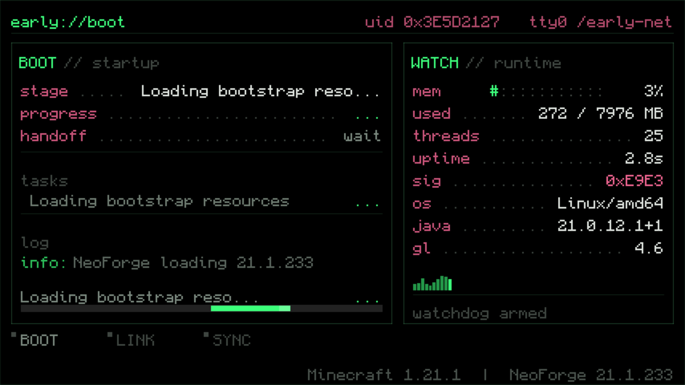

# Early Window

给 NeoForge 用的替代启动界面：接管 FML 早期加载窗口，画一套终端（TUI）风格的启动画面——
`BOOT // startup` / `WATCH // runtime` 双面板、进度条、启动日志、实时内存与线程数。



它是一个 **独立 jar**（不是模组），放进 `mods/` 并改一行配置即可生效，不影响任何游戏内容。

## 特性

- 终端风格双面板 + 状态灯 + 页脚版本信息，纯 ASCII 像素字渲染；
- BOOT 面板：当前加载阶段、FML 进度条、启动日志流；
- WATCH 面板：内存占用、线程数、运行时长、平台/Java/GL 版本、堆占用曲线；
- 不显示 Mojang 过渡图标，深色配色；
- 渲染失败自动退回 NeoForge 默认界面，不崩游戏。

## 要求

| 项目 | 版本 |
| --- | --- |
| Minecraft | 1.21.1 |
| NeoForge | 21.1.x（已在 21.1.233 验证） |
| FancyModLoader | 4.0.x（已在 4.0.42 验证） |
| Java | 21 |

## 安装

1. 把 `early-window-<version>.jar` 放进 `mods/`；
2. 在 `config/fml.toml` 里指定 provider：

```toml
earlyWindowProvider = "earlywindow"
```

3. 启动客户端，日志出现下面两行即生效：

```
Loading ImmediateWindowProvider earlywindow
早期加载屏已接管（替换 4 个自定义元素）
```

> jar 必须单独放，不要合并进模组本体——合并会让整个 jar 被 FML 提前加载，模组本身反而加载不了。

## 构建

```fish
./gradlew build        # 产物：build/libs/*.jar 与 build/distributions/*.zip
./gradlew checkLayout  # 无 GPU 环境下的排版/逻辑断言
```

依赖只在编译期使用，jar 内不含任何第三方 class；首次构建需要联网解析依赖，之后可离线。

## 与 graft 模组配合开发

```fish
./gradlew installToGraftDev     # 复制到 ../graft/run/mods
cd ../graft && ./gradlew runClient
```

## 文档

- [实现说明](docs/design.md)：工作原理、渲染与断言、版本兼容、调试手段
- [故障排除](docs/troubleshooting.md)：provider 没生效、模块重名等常见问题

## 许可

MIT，见 [LICENSE](LICENSE)。
